<div align="center">

# PaperView

**A calm, fast reader for your PDFs and ebooks. Free, no ads, no accounts.**

[](https://github.com/nagasab221/PaperView-Desktop/releases/latest)
[](#install)
[](LICENSE)

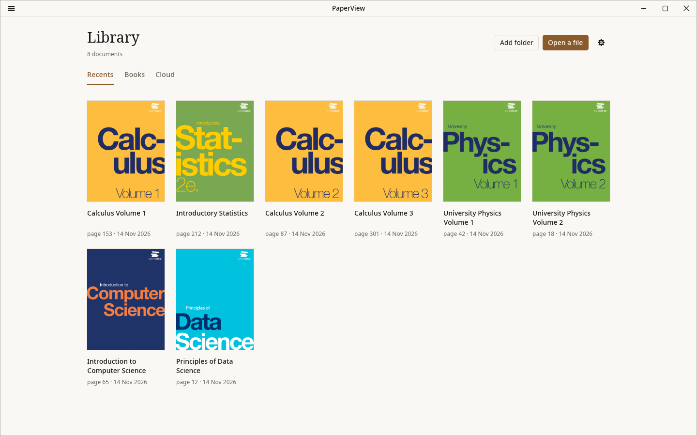

</div>

PaperView keeps everything you're reading on one shelf, opens each file right where you left off, and gets out of the way while you read. It's the desktop companion to the [PaperView Android app](https://github.com/nagasab221/Paperview): same look, same cloud. It runs on **Linux** today; a Windows version is on the way.

## Install

Paste this into a terminal (no root or password needed):

```sh
curl -fsSL https://raw.githubusercontent.com/nagasab221/PaperView-Desktop/main/install.sh | sh
```

Then open **PaperView** from your app menu. Run the same line again any time to update; your library and settings are kept.

<details>
<summary>Other ways to install, and how to remove it</summary>

**Download by hand:** get `PaperView-linux-x86_64.tar.gz` from the [latest release](https://github.com/nagasab221/PaperView-Desktop/releases/latest), unpack it and run `./install.sh` inside. You can also run `./paperview` straight from the folder without installing.

**Remove:** `~/.local/opt/paperview/uninstall.sh`. Your library and settings stay in `~/.local/share/paperview`; delete that folder too to forget everything.

**Works on** 64-bit Linux distributions from about 2022 on (Ubuntu 22.04, Debian 12, Fedora 36, Linux Mint 21, Arch and their successors), on Wayland or X11.

**Build from source** (needs [Rust](https://rustup.rs)):

```sh
git clone https://github.com/nagasab221/PaperView-Desktop.git
cd PaperView-Desktop
scripts/fetch-pdfium.sh
cargo build --release
scripts/install-linux.sh
```

**Printing** uses CUPS, the standard Linux printing system. If PaperView says it's missing, install it (Arch: `sudo pacman -S cups && sudo systemctl enable --now cups`; Ubuntu/Debian: `sudo apt install cups`) and add your printer in your system settings.

</details>

## What it does

### 📚 One shelf for everything you read

Every PDF you open lands on the shelf with its cover and the page you're on. Ebooks get their own **Books** tab, showing how far you've read. **Add a folder** (or drop one onto the window) to see every PDF in it, subfolders included. Files you delete or rename leave the shelf by themselves.

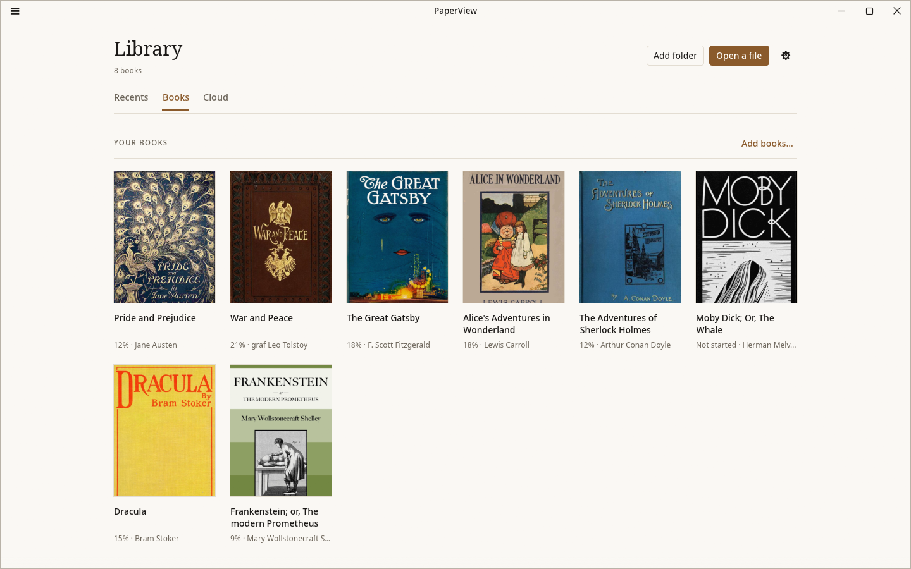

### 📄 PDFs, sharp at any size

Tabs for several documents, smooth scrolling or one page at a time, and zoom that stays crisp: fit the page, fit the width, or anything in between. Search the whole document, select and copy text (**Ctrl+C**), follow links, browse page thumbnails or the table of contents, and jump straight to any page with **Ctrl+G**. Password-protected PDFs and printing work too.

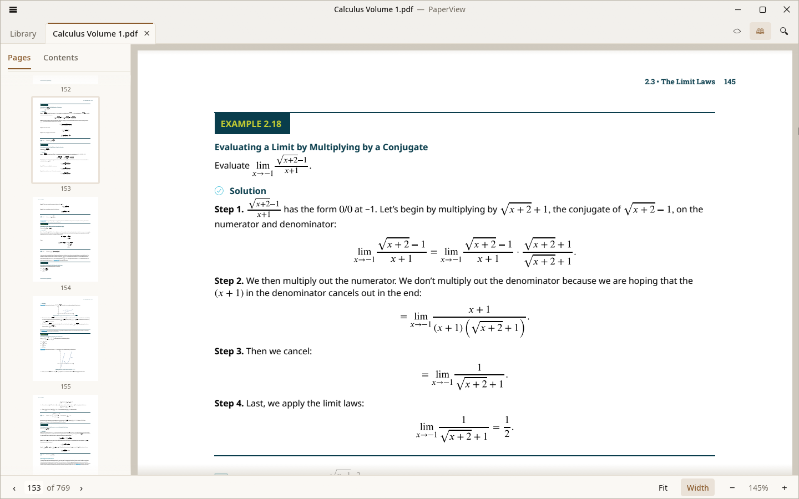

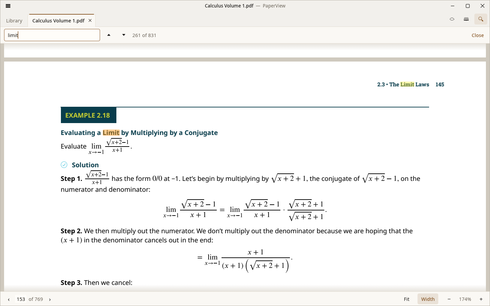

### 👁 Peek: check the answers without losing your place

Made for working through questions while the answers are at the back of the book.

1. Go to the answer key and press **Shift+Q** to set a peek spot.
2. **Hold Q** to look at it. Let go and you're back exactly where you were.
3. **Tap Q** to go there, and tap again to come back.

The eye button in the bottom bar does the same with the mouse. Each document remembers its own peek spot.

### 📖 Ebooks, set like a printed book

EPUB, Kindle (MOBI, AZW3, without DRM), FB2, comics (CBZ), plain text and HTML open as two facing pages that meet at the spine, or as one page at a time. Turn pages with the arrow keys, Space, the mouse wheel or a click on either side. The bar shows your chapter and how many pages are left in it, and the thin progress line above it takes you anywhere in the book with one click.

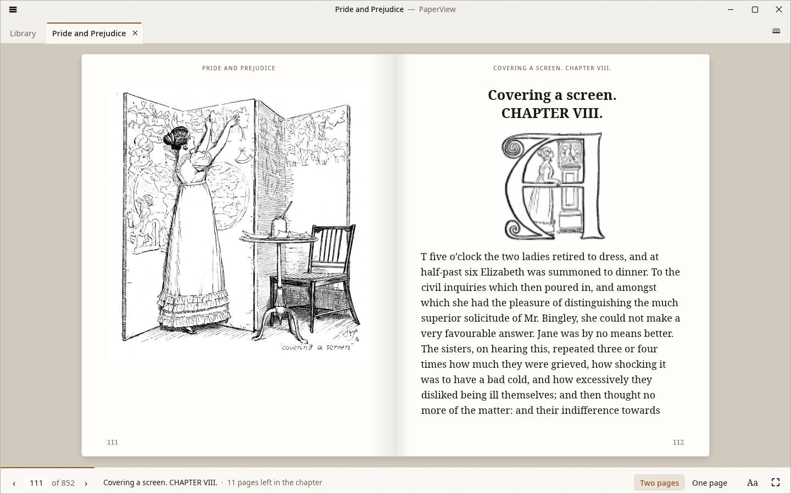

**Aa** picks the typeface (Literata, Merriweather, EB Garamond, Lora, Source Serif, Noto Serif and Sans, Atkinson Hyperlegible and OpenDyslexic), the text size, line spacing, margins, and indented or spaced paragraphs.

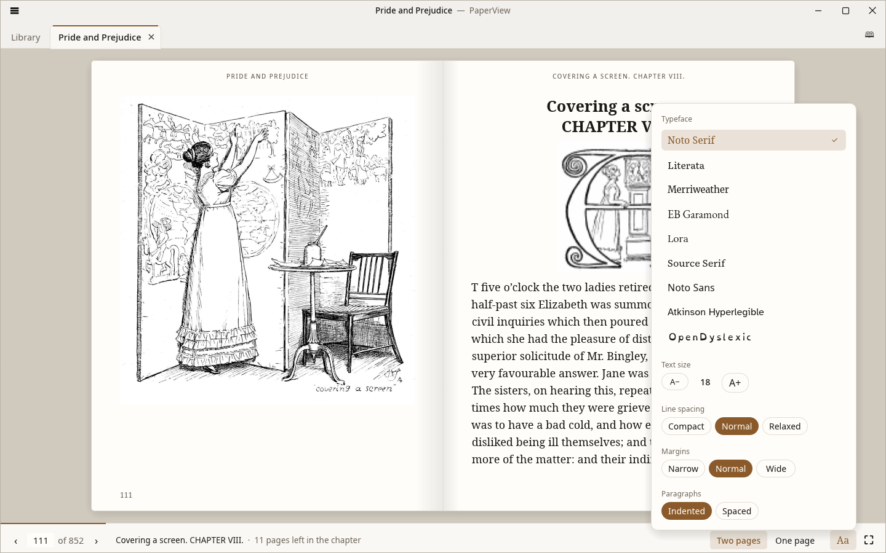

Press **F11** for full screen with nothing but the pages. A small bar appears when you move the mouse, and **Esc** brings everything back.

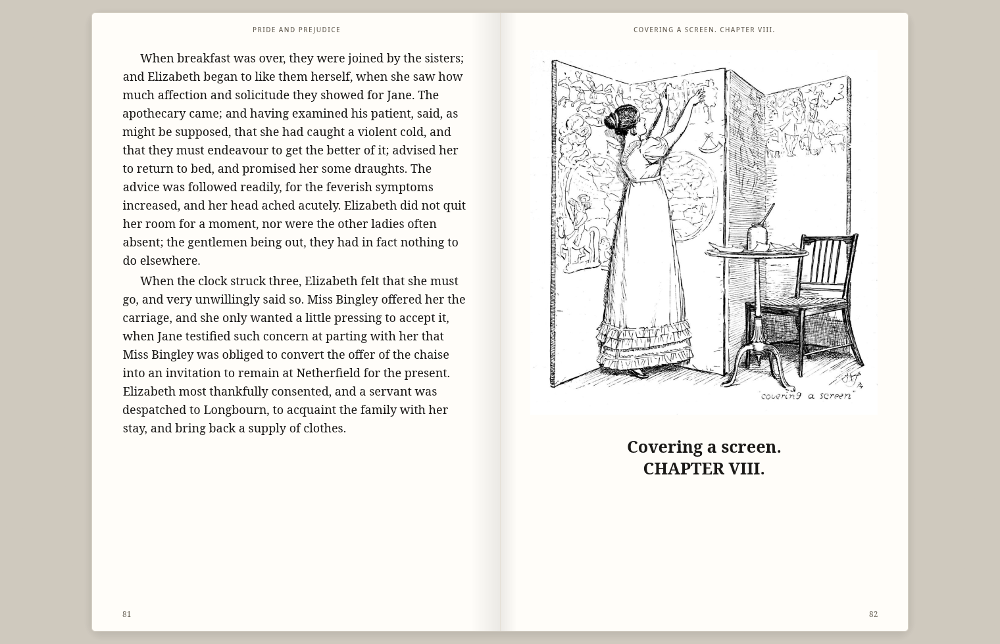

### ☁ Your own cloud, if you want one

Keep documents somewhere besides this computer: a **NAS**, **another computer over SSH**, or a cloud bucket. Add as many accounts as you like and switch between them on the Cloud tab, which shows each account's folders so you can browse, make new ones, and upload straight into them. Save a document with the **☁** button or by right-clicking it in Recents, and rename it on the way if you like. Nothing uploads unless you ask, and none of it appears until you add an account.

| Account type | Works with |
|---|---|
| **Folder** | Any folder: a mounted NAS share (SMB, NFS, sshfs), a Syncthing or Nextcloud folder. Documents open straight from it. |
| **WebDAV** | Nextcloud, ownCloud, Synology, QNAP, TrueNAS, OpenMediaVault, Koofr… |
| **S3** | Cloudflare R2, Wasabi, AWS S3, MinIO, iDrive e2 and anything else that speaks S3 |
| **Backblaze B2** | Your private B2 bucket (10 GB free), the same bucket the phone app uses |
| **SSH** | Any computer or NAS you can `ssh` into. It uses your SSH keys and `~/.ssh/config`, and no password is stored |

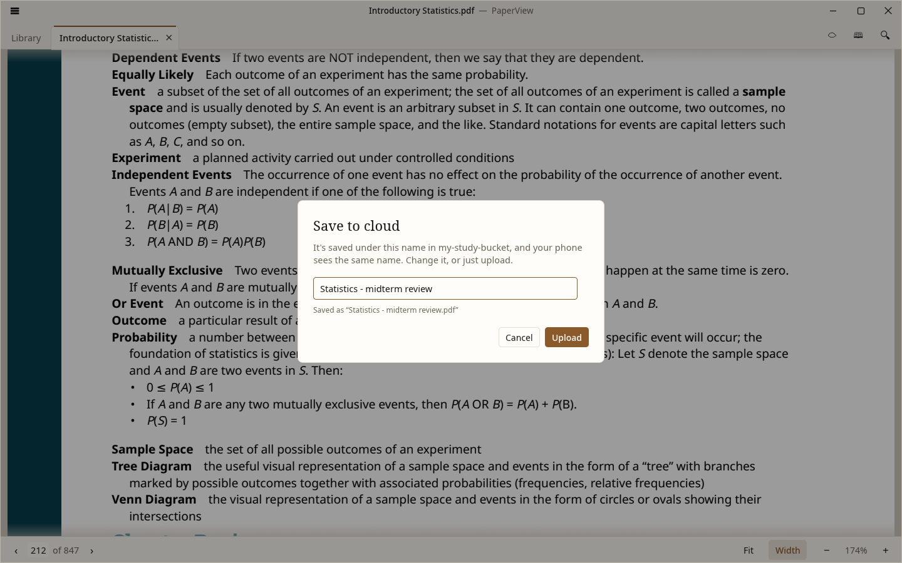

<details>
<summary>Setting up an account</summary>

1. Open **Settings** (⚙ in the Library, or **Ctrl+,**).
2. Under **Cloud**, click **Add account**, pick the type and fill in the details. For example:
   - **SSH:** the host (an alias from `~/.ssh/config` works) and a folder, `PaperView` by default, which is made if it's missing. Set up key login first (`ssh-copy-id host`).
   - **WebDAV:** the folder's full address, such as `https://nas.local:5006/PaperView` or `https://cloud.example.com/remote.php/dav/files/you/PaperView`, plus your user name and password. A NAS with a self-signed certificate needs **Trust a self-signed certificate**.
   - **S3:** the endpoint (such as `https://<account>.r2.cloudflarestorage.com`), the region (`auto` for R2), the bucket and an access key.
   - **Backblaze B2:** create a private bucket and an application key at [backblaze.com](https://www.backblaze.com/cloud-storage), then enter the Key ID, the application key and the bucket name.
3. Click **Save and connect**. A **Cloud** tab appears in your Library. Upload with ☁, from the right-click menu, or by dropping documents onto the Cloud tab.

</details>

### 🎨 Eleven styles, light and dark

Paper, Slate and Ink (as on the phone) plus a style for every main colour: Cherry, Apricot, Saffron, Forest, Lagoon, Cobalt, Lavender and Blossom. Each comes in light and dark, or follows your system, and every one keeps text easy to read. A **Size** slider makes the whole app more compact or larger.

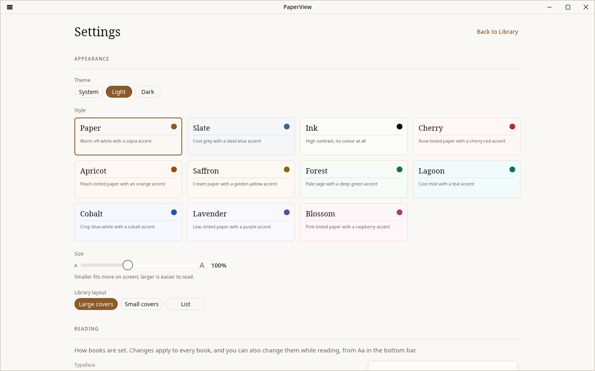

<table>
<tr>
<td>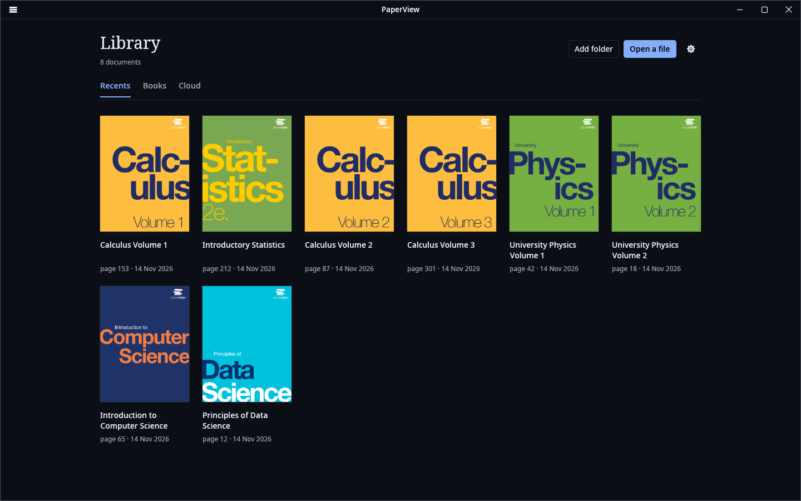</td>
<td>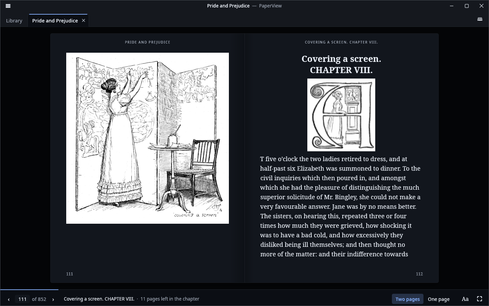</td>
</tr>
</table>

## Keyboard shortcuts

| Keys | Does |
| --- | --- |
| **Ctrl+O** | Open a PDF or ebook |
| **Ctrl+F** | Find in the document (Enter for the next match) |
| **Ctrl+G** | Go to a page |
| **Ctrl+C** / **Ctrl+A** | Copy the selected text / select all |
| **F11** / **Esc** | Full screen / leave full screen |
| **Hold Q** / **Tap Q** | Peek at your saved spot / jump there and back |
| **Shift+Q** | Set or move the peek spot |
| **Ctrl+=** / **Ctrl+-** / **Ctrl+0** | Zoom in / out / actual size (text size in books) |
| **PgUp** / **PgDn**, **Home** / **End** | Previous / next page, first / last page |
| **← / →**, **Space** | Turn the page in a book |
| **Alt+Left** / **Alt+Right** | Back / forward after following a link |
| **Ctrl+Tab** / **Ctrl+W** | Next document / close document |
| **Ctrl+Shift+T** | Reopen the last closed document |
| **Ctrl+P** / **Ctrl+S** | Print / save a copy |
| **Ctrl+,** | Settings |

## Privacy

- No ads, no analytics, no accounts.
- Everything works offline. The network is only used if you add a cloud account, and then only to talk to that account.
- Passwords and keys are kept in your system keyring (KWallet, GNOME Keyring or the Windows Credential Manager), not in PaperView's settings. SSH accounts store no password at all.

## Credits

PaperView is written in Rust with [egui](https://github.com/emilk/egui); pages are drawn by [PDFium](https://pdfium.googlesource.com/pdfium/). The reading typefaces are open-source fonts under the SIL Open Font License. How it all fits together is in [docs/DEVELOPER_NOTES.md](docs/DEVELOPER_NOTES.md).

The screenshots show free textbooks from [OpenStax](https://openstax.org) (CC BY 4.0) and public-domain classics from [Project Gutenberg](https://www.gutenberg.org).

PaperView is released under the [MIT licence](LICENSE).
